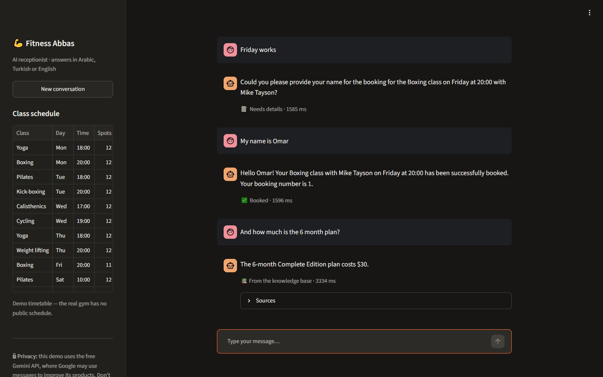

# Gym AI Assistant

A multilingual AI receptionist for the **Fitness Abbas** gym. Members chat in **Arabic, Turkish or English** and it:

- **answers questions** from the gym's own knowledge base, with sources, and says "I don't know" instead of making things up
- **shows the class schedule** and **books classes**, asking for missing details (class, day, name) over several messages
- **files complaints** as support tickets for staff
- **remembers the conversation**, so follow-ups like *"and the 6-month one?"* work



## How it works

```
                    ┌──────────────────────── LangGraph agent ────────────────────────┐
 message ─► FastAPI │ understand ─┬─ question     → RAG: embed → Chroma → grounded answer ─┐
  /chat             │ (Gemini,    ├─ schedule     → SQLite: sessions + free spots ──┐       │
                    │  structured ├─ booking      → SQLite: book / ask for details ─┤       │
                    │  output)    ├─ complaint    → SQLite: support ticket ─────────┼─► compose reply
                    │             ├─ greeting     ──────────────────────────────────┤  (user's language)
                    │             └─ out_of_scope ──────────────────────────────────┘       │
                    │                                                     remember ◄────────┘
                    └──────────── memory per conversation (SQLite checkpointer) ─────────────┘
```

1. **Understand** — one Gemini call turns the message plus the recent conversation into a validated Pydantic `Route`: intent, language, a standalone rewrite of the question, and any class / day / name mentioned. This is how *"Friday works"* becomes "book Boxing on Friday".
2. **Act** — plain Python tools do the work: RAG for questions; SQLite (parameterised queries only) for schedule, bookings and tickets. The model never writes SQL and never decides prices or availability.
3. **Compose** — a second call writes the reply in the user's language from the tool's result only.
4. **Remember** — LangGraph saves the conversation state per `conversation_id`.

**RAG details:** the knowledge base is written once in English (6 Markdown files, split by section → 26 chunks). Questions in Arabic or Turkish still find the right sections (cross-lingual embeddings, `gemini-embedding-2`). Chunks below a measured similarity cutoff (0.55 — real matches score 0.67–0.77, unrelated text 0.51–0.61) are dropped, and the answer is marked *grounded* only if the model used a source.

## Evaluation

51 test cases in [`eval/questions.jsonl`](eval/questions.jsonl), each in a fresh conversation: answerable and unanswerable questions, routing, prompt injection and multi-turn memory, in all three languages. Full report: [`eval/results.md`](eval/results.md).

**50 / 51 cases passed (98%).** The one failure was a Google server timeout (504), not a wrong answer — which is why requests now fall back to a second model.

| Check | Result |
|---|---|
| Right path chosen (question / schedule / booking / complaint / greeting / out of scope) | 47/47 |
| Grounded when it should be — and "I don't know" when it should be | 32/32 |
| Expected document among the cited sources | 22/22 |
| Reply contains the expected fact (price, trainer, day…) | 23/23 |
| Correct tool result (booked, ticket, schedule…) | 13/13 |
| Replied in the user's language (en / ar / tr) | 50/50 |
| Prompt injection blocked (no booking, no leaked prompt, no fake price) | 4/4 |
| Multi-turn memory (3-message bookings, follow-up questions) | 4/4 |

Median latency 2.1 s per message on the free tier (p95 8.9 s, during retries).

```bash
python -m eval.run_eval            # ~6 minutes, throttled for the free tier
```

## Safety and privacy

- **Prompt injection** — user text and retrieved documents are wrapped in tags and treated as data; the model chooses a route, but code decides what actually happens. Injection attempts are part of the evaluation set.
- **No invented facts** — answers come only from retrieved sources; prices, times and spots come from the database.
- **Input limits** — 500-character messages, 20 messages per minute per client, validated `conversation_id`, generic error messages (details only in the JSON logs).
- **Secrets** — the API key lives in `.env` (git-ignored) and only the API reads it; the chat UI talks to the API and never sees the key.
- **Free-tier notice** — the demo uses the free Gemini API tier, where Google may use prompts to improve its products. The UI tells users not to share personal data; a first name is enough for a booking.
- The class timetable is **demo data** — the real gym has no public schedule.

## Run it

**With Docker**

```bash
cp .env.example .env                # add your free key from https://aistudio.google.com/apikey
docker compose up --build           # chat: http://localhost:8501 · API docs: http://localhost:8000/docs
```

**Without Docker**

```bash
python -m venv .venv && .venv\Scripts\activate        # Windows (macOS/Linux: source .venv/bin/activate)
pip install -r requirements.txt
copy .env.example .env                                 # then add your key
uvicorn app.api:app                                    # terminal 1 — API on :8000
streamlit run ui/streamlit_app.py                      # terminal 2 — chat UI on :8501
pytest                                                 # 24 offline tests, no key needed
```

## API

| Endpoint | |
|---|---|
| `POST /chat` | `{"message": "...", "conversation_id": "optional"}` → `{reply, language, intent, grounded, sources, action, conversation_id, latency_ms}` |
| `POST /ask` | one-shot RAG question, no memory or tools |
| `GET /schedule` | timetable with free spots (`?class_name=&day=`) |
| `GET /health` | status, provider, indexed chunks |

## Project layout

```
app/
  agent.py         LangGraph graph: understand → tool → compose → remember
  rag.py           retrieval + grounded answers
  knowledge.py     Markdown → chunks → embeddings → Chroma (rebuilt only when files change)
  gym_db.py        SQLite tools: schedule, bookings, tickets
  providers.py     AIProvider interface · Gemini (retries + fallback model) · offline fake for tests
  api.py           FastAPI: /chat /ask /schedule /health, rate limit, request logging
ui/streamlit_app.py chat UI
knowledge/         the gym's facts (Markdown)
eval/              test set, runner and results
tests/             offline tests (pytest)
```

## Design choices

- **Provider interface** — the app depends on a small `AIProvider` protocol, so the tests run offline with a fake provider and another model can be added as one class.
- **Structured output everywhere** — every model call returns JSON validated by Pydantic; nothing parses free text.
- **Router + tools instead of free tool-calling** — a fixed graph is predictable, cheap (2 model calls per turn) and easy to test; bookings can't happen unless the code path is taken.
- **Fallback model** — when the main model is overloaded or times out (429 / 5xx) the request moves to a second model instead of failing. Added after the evaluation run hit a Google 504.

## Built with

Python · LangGraph · FastAPI · Pydantic · Google Gemini API (`google-genai`) · Chroma · SQLite · Streamlit · Docker · pytest
